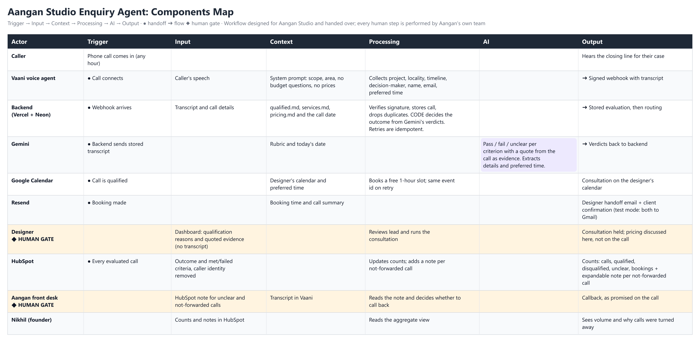

# Aangan Studio Enquiry Agent (MVP)

An AI phone agent for **Aangan Studio**, a Pune interior design firm. It answers incoming enquiry calls, decides which callers are worth a designer's time, books the good ones onto a designer's calendar, and gives the founder a simple count of what happened.

> Built as a handoff workflow for the client (Case 03, Nikhil Deshpande). Every human step in it is done by Aangan's own team: designers, front desk and the founder.



## The problem in one paragraph
Aangan gets about 200 enquiries a month. The front desk (2 people) cannot keep up: roughly a third of calls arrive outside office hours and about half of enquiries get no reply within 48 hours, while a designer who answers within an hour converts about 4x better. Many calls are also not a fit (wrong area, gyms and restaurants, advice only, impossible timelines), and they cost designer time to find out.

## What it does

1. **Answers the call** (Vaani voice agent, any hour). It collects the project, locality, timeline, whether the caller is the decision-maker, name, email and preferred time for a conversation. It never asks about budget and never quotes a price.
2. **Stores the call** the moment it ends (signed webhook, saved in Neon Postgres before anything else happens).
3. **Evaluates the transcript** with Gemini against the rules in `knowledge/` (`qualified.md`, `services.md`, `pricing.md`). Gemini judges each of five criteria as pass, fail or unclear and quotes the caller as evidence. **The code, not the AI, decides the outcome** (`src/core/rules.ts`).
4. **Routes the result**

| Outcome | What happens |
|---|---|
| **Qualified** | Assigned to a designer, booked on their Google Calendar (at the caller's preferred time when free), designer gets a handoff email, caller gets a confirmation email, lead appears on the designer dashboard. |
| **Disqualified** | Not forwarded. A note goes to the founder's HubSpot with the reasons, the evidence and which criteria were still met. No caller name, email or phone is put in HubSpot. |
| **Unclear** (complaints, dropped calls, unresolved timeline) | Not forwarded. Same kind of HubSpot note. The caller was told "Someone from our front desk team will get back to you at the earliest." |

5. **Reports to the founder** in HubSpot: running counts (calls, qualified, disqualified, unclear, consultations booked) plus an expandable note for each call that was not forwarded.

### The five criteria
Real project in scope, inside the service area (Pune and PCMC), workable timeline, budget not clearly misaligned (only judged if the caller volunteers it), and a real decision-maker.

### Design choices worth knowing
- **AI judges, code decides.** A "fail" from Gemini only counts if its quote really appears in the transcript; otherwise it is downgraded to "unclear". A made-up rejection cannot close a lead.
- **Safe to retry.** Duplicate webhooks are ignored, two workers cannot evaluate the same call, the calendar event has a deterministic id, and each email is sent at most once. Booking failures are flagged and retried (`POST /api/jobs/retry`).
- **Humans stay in the loop.** Designers run the consultation (pricing is discussed there). The front desk handles callbacks. Nothing consequential is automated.
- **Privacy.** Designers see reasons and quoted evidence but not transcripts. The founder endpoint returns counts only.

## Architecture

```
Caller ─► Vaani voice agent ─► signed webhook ─► Next.js on Vercel ─► Neon Postgres
                                                        │
                                                        ├─► Gemini (evaluates stored transcript)
                                                        ├─► Google Calendar (consultation booking)
                                                        ├─► Resend (designer + client emails)
                                                        └─► HubSpot (counts + notes for the founder)
```

| Path | Purpose |
|---|---|
| `src/app/api/webhooks/vaani/call-completed/route.ts` | Receives the call, verifies the signature, stores it, evaluates in the background |
| `src/core/rules.ts` | The outcome rules (qualified / disqualified / unclear) |
| `src/core/pipeline.ts` | Evaluate, assign designer, book, notify, retry |
| `src/integrations/` | One file per outside service: `gemini.ts`, `gcal.ts`, `resend.ts`, `hubspot.ts`, `vaani/` |
| `src/app/designer/page.tsx` | Designer dashboard |
| `knowledge/` | Read-only copies of the three case rule files fed to Gemini |
| `vaani/agent-prompt.md` | The voice agent's system prompt |
| `migrations/` | Database schema |
| `test/` | Offline tests (embedded Postgres, faked outside services) |

## Quick start (no accounts needed)

```bash
npm install
cp .env.example .env.local          # DATABASE_URL=pglite:.pglite works without Neon
npm run db:migrate
npm run db:seed-designers -- "Asha:asha@example.com"
npm run dev                         # http://localhost:3000/designer
npm test                            # 23 tests, fully offline
```

Send a fake call to a running server (signed like a real Vaani webhook). It needs `GEMINI_API_KEY` for a real evaluation:

```bash
npm run simulate -- t01             # qualified
npm run simulate -- t03             # Nashik, outside the service area
npm run simulate -- lowbudget       # volunteered budget far too low
npm run simulate -- complaint       # existing client complaint (unclear)
```

Other helpers: `npm run db:seed-demo` (16 showcase leads, flagged as demo and excluded from real routing; `-- --clear` removes them), `npm run setup:hubspot` (creates the `aangan_*` count properties), `npm run hubspot:demo` (company profile and demo notes).

## Configuration
Copy `.env.example` to `.env.local`. Never commit real values.

| Variable | Used for |
|---|---|
| `DATABASE_URL` | Neon connection string, or `pglite:.pglite` locally |
| `VAANI_WEBHOOK_SECRET` | Verifies the `x-webhook-signature` header |
| `GEMINI_API_KEY`, `GEMINI_MODEL` | Evaluation (default model `gemini-flash-latest`) |
| `GOOGLE_SERVICE_ACCOUNT_JSON` | Calendar booking; each designer shares their calendar with the service account |
| `RESEND_API_KEY`, `EMAIL_FROM` | Emails |
| `EMAIL_TEST_MODE`, `EMAIL_TEST_RECIPIENT` | While on, every email goes to the test inbox with a `[TEST for ...]` subject. Set `EMAIL_TEST_MODE=false` to email real people. |
| `HUBSPOT_TOKEN`, `HUBSPOT_COMPANY_ID` | Founder counts and notes |
| `FOUNDER_TOKEN` | Bearer token for `GET /api/metrics` (counts only) |
| `JOBS_TOKEN` | Bearer token for the retry job; call `POST /api/jobs/retry` about every 5 minutes |
| `DESIGNER_PASSWORD` | Designer dashboard password (demo default `designer_aangan`) |

## Setting up the live pieces
1. **Vaani:** create an agent, paste `vaani/agent-prompt.md` as its system prompt, add a webhook to `https://<your-app>/api/webhooks/vaani/call-completed` for the call post-processing event, and use the same secret as `VAANI_WEBHOOK_SECRET`. Use a non-disabled LLM provider.
2. **Neon and Vercel:** create the database, set the env vars, deploy, then run `npm run db:migrate` and `npm run db:seed-designers`.
3. **Google Calendar:** create a service account, share each designer's calendar with it ("make changes to events"), and set the JSON key.
4. **HubSpot:** create a service key, set `HUBSPOT_TOKEN` and `HUBSPOT_COMPANY_ID`, then run `npm run setup:hubspot`.

## Status and known limits
- Verified end to end with real Vaani web test calls: webhook, storage, Gemini verdicts, designer dashboard, Google Calendar booking, Resend emails and HubSpot updates.
- **Not yet seen:** a real phone call (all tests were web calls), so the caller-number format from a real telephone call is unconfirmed.
- Email is in **test mode**. The designer dashboard uses a shared **demo password** with no lockout; replace it before real use.
- A caller who partly fits but fails a rule still gets the front desk line, but is not booked; only the HubSpot note records them, so someone must act on it.
- Not built: a cost-of-running view, reclassifying a rejected call as qualified (backlog), WhatsApp and web forms (out of scope).
- Transcripts of calls not forwarded stay in Vaani's own interface.

## Source-file conflicts noticed
- **Timeline:** `qualified.md` says 8 to 10 weeks, `services.md` says under 6 weeks is the hard limit. The evaluator fails only when the need is clearly impossible (under about 6 weeks).
- **T18** (180 sq ft coworking pod) was declined citing a 500 sq ft commercial minimum that is not in `services.md`, so it is not encoded.
